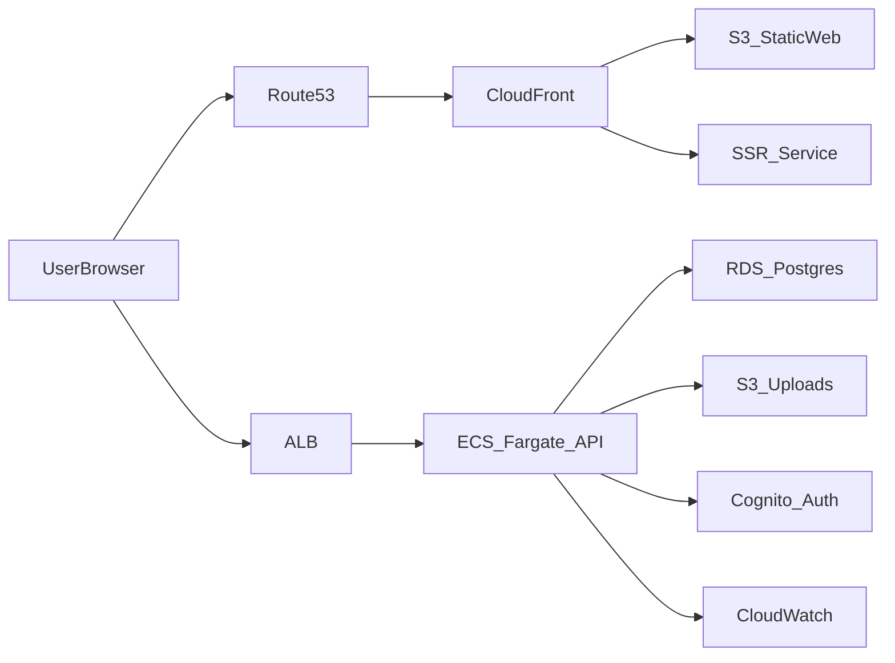

# AWS Architecture (MVP -> Launch)

## Overview

- Frontend app: Vite SPA on S3 + CloudFront
- Public marketing site: SSR/SSG (Next.js or Astro) for SEO
- API: single service on ECS Fargate behind ALB
- Database: RDS PostgreSQL
- Auth: Cognito
- File storage: S3 uploads bucket
- Observability: CloudWatch logs/metrics

## Goals

- Simple ops footprint that scales without re-architecture
- SEO-ready public site for acquisition and investor demos
- Clear separation between public marketing and authenticated app
- AWS-first hosting with minimal managed services

## Hosting Plan (Current + Future)

- Public site: SSR/SSG (Next.js/Astro)
  - Routes like `/`, `/how-it-works`, `/privacy`, `/cities/{city}`
  - Optimized for SEO, share previews, and marketing conversion
- App: SPA
  - Routes like `/onboarding`, `/discovery`, `/profile/:id`, `/messages/:id`
  - Optimized for fast authenticated flows and low operational complexity

## Mermaid Diagram (Detailed)



## Plain Text Diagram (Fallback)

```
UserBrowser
  |
  +--> Route53 --> CloudFront --> S3_StaticWeb (SPA)
  |                            --> SSR_Service (Marketing)
  |
  +--> ALB --> ECS_Fargate_API --> RDS_Postgres
                    |             |
                    |             +--> CloudWatch
                    +--> S3_Uploads
                    +--> Cognito_Auth

## Description (for future reference)

- Route53 provides DNS routing for both the marketing domain and the app domain.
- CloudFront serves the static SPA from S3 and forwards marketing routes to SSR/SSG.
- The API is isolated behind an ALB and runs as a single ECS Fargate service.
- RDS Postgres stores core data; S3 stores profile images and uploads.
- Cognito handles authentication and token issuance.
- CloudWatch aggregates logs and metrics for both API and SSR services.

## Notes

- The SSR service can be ECS Fargate, Lambda, or a managed framework host later.
- Keep the API as the single source of business logic to avoid lock-in.
- This design keeps the app fast while enabling SEO and investor-ready pages.
```
