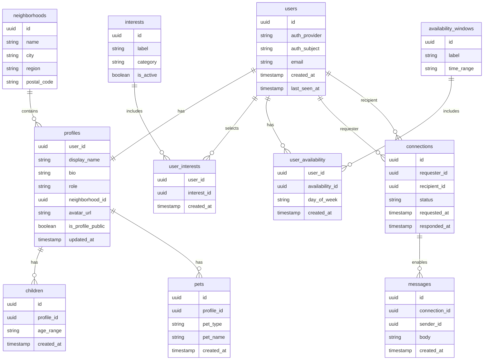

# Data Model (MVP -> Launch)

## Overview

This model supports:

- Onboarding (role, neighborhood, interests, availability)
- Discovery (matching by neighborhood + overlap)
- Connection requests + accept/decline
- Messaging after mutual acceptance
- Profile management and privacy basics

## Core Entities (High-level)

- `users`: account identity (auth mapped)
- `profiles`: public-facing user info
- `neighborhoods`: normalized location buckets
- `children`: optional child details per profile
- `pets`: optional pet details per profile
- `interests`: canonical interests
- `user_interests`: many-to-many between users and interests
- `availability_windows`: canonical time windows (morning/afternoon/evening)
- `user_availability`: user availability by day and window
- `connections`: mutual connection state between two users
- `messages`: 1:1 messages between connected users

## Mermaid ERD (Detailed)



## Plain Text ERD (Fallback)

```
users 1--1 profiles
profiles *--1 neighborhoods
profiles 1--* children
profiles 1--* pets

users *--* interests (via user_interests)
users *--* availability_windows (via user_availability)

users 1--* connections (requester)
users 1--* connections (recipient)
connections 1--* messages
```

## Key Notes

- `users` ties to auth provider (Cognito) with `auth_provider` + `auth_subject`.
- `profiles` are separate to keep auth data minimal and allow privacy controls.
- `children` and `pets` are optional detail tables linked to `profiles`.
- Matching uses shared `interests`, overlapping `user_availability`, and same `neighborhood`.
- `connections` enforces mutual consent before `messages` are visible.

## Status/Enum Suggestions

- `profiles.role`: `parent | pet | both`
- `connections.status`: `pending | accepted | declined | blocked`
- `user_availability.day_of_week`: `mon | tue | wed | thu | fri | sat | sun`
