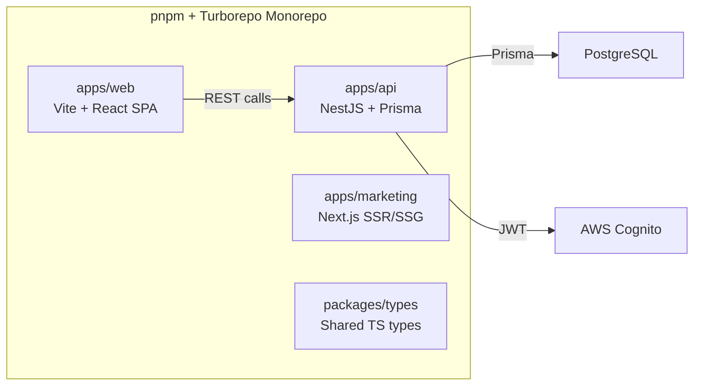
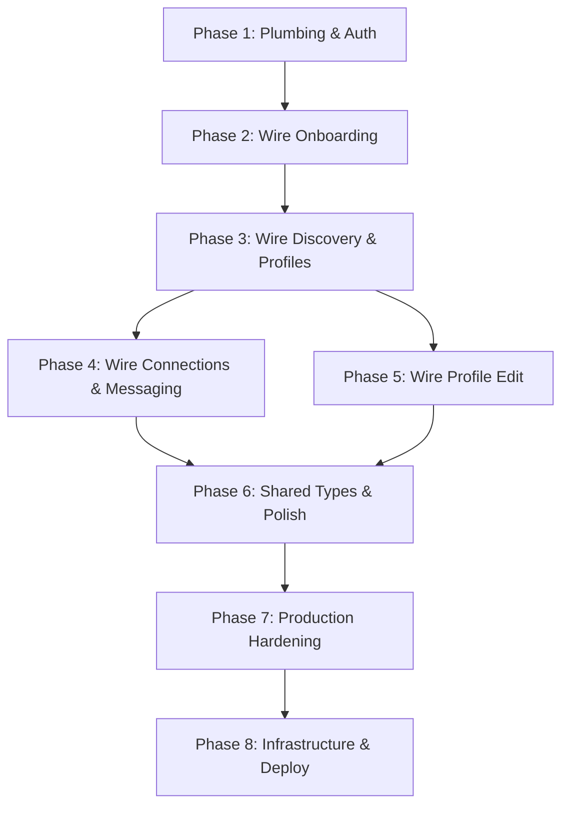

# Neighborhood Connect — Implementation Plan

## Application Overview

**Neighborhood Connect** is a neighborhood-based connection platform for **parents of young children (0–5)** and **pet parents**. It enables intentional, real-world meetups by matching neighbors who share interests, overlapping availability, and the same neighborhood. It's utility-first — not social media.

### Architecture

---

## Current State Analysis

### ✅ What's Built

| Layer | Component | Status |
|-------|-----------|--------|
| **API** | NestJS scaffold with 10 modules | ✅ Scaffolded with controllers + services |
| **API** | Prisma schema (11 models) | ✅ Complete, matches data-model.md |
| **API** | Seed data (5 interests, 3 time windows) | ✅ Working |
| **API** | Auth guard (Cognito JWT + `x-user-id` dev header) | ✅ Working |
| **API** | Dev-login endpoint | ✅ Working |
| **API** | Profile CRUD (upsert, get, interests, availability) | ✅ Working |
| **API** | Discovery service (neighborhood + overlap matching) | ✅ Working |
| **API** | Connections (create, list, update status) | ✅ Working |
| **API** | Messages (list, send — gated by accepted connection) | ✅ Working |
| **API** | Neighborhoods (search, get by id) | ✅ Working |
| **API** | Interests & Availability (list) | ✅ Working |
| **API** | Global prefix `/v1`, ValidationPipe | ✅ Configured |
| **Web** | Vite + React + TypeScript + Tailwind | ✅ Configured |
| **Web** | React Router with 10 routes | ✅ Working |
| **Web** | shadcn/ui component library (45+ components) | ✅ Installed |
| **Web** | Pages: Onboarding flow (4 steps) | ✅ UI built (hardcoded data) |
| **Web** | Pages: Discovery, Profile, ConnectionSent | ✅ UI built (hardcoded data) |
| **Web** | Pages: Messages, ProfileEdit | ✅ UI built (hardcoded data) |
| **Marketing** | Next.js with layout, 6 pages | ✅ Working |
| **Shared** | `packages/types` skeleton | ✅ Empty shell |

### 🔴 Critical Gaps

> [!IMPORTANT]
> The **biggest gap** is that the web app is **entirely static/hardcoded**. The `apps/web/src/api/index.ts` is empty (`export {}`). No API calls are being made. All pages use inline mock data.

| Gap | Description |
|-----|-------------|
| **No API client** | `apps/web/src/api/index.ts` is empty — no HTTP client, no service layer |
| **No auth flow** | Web has no login/session management. No user context provider |
| **Onboarding not persisted** | Neighborhood selection, role, interests, availability are UI-only |
| **Discovery is static** | Uses hardcoded 3-match array, not the `/v1/discovery` endpoint |
| **Profiles are static** | Hardcoded `profilesData` object, not fetched from API |
| **Connections not wired** | "Connect" button does nothing; no POST to `/v1/connections` |
| **Messages are static** | Hardcoded messages, not fetched/sent via API |
| **ProfileEdit not persisted** | Save button shows a toast but doesn't call API |
| **No CORS config** | API has no CORS enabled — web can't call it cross-origin |
| **No shared types** | `packages/types` is empty — no shared DTOs between web and API |
| **No seed neighborhoods** | The seed file doesn't create neighborhoods, so onboarding can't work |
| **No connections list page** | There's no "My Connections" page in the web app |
| **No real auth** | Only dev-login with `x-user-id` header — no Cognito integration |
| **No infrastructure** | Terraform IaC is documented but not implemented |
| **No CI/CD** | No deployment pipeline or automated testing |
| **No observability** | No structured logging, monitoring, or health checks |

---

## Implementation Phases

### Phase 1: Plumbing & Auth Foundation
> Make the API callable from the web app with authenticated user context.

| # | Task | Files |
|---|------|-------|
| 1.1 | Enable CORS on API | `apps/api/src/main.ts` |
| 1.2 | Create API client module | `apps/web/src/api/client.ts` |
| 1.3 | Create API service functions | `apps/web/src/api/*.ts` |
| 1.4 | Create Auth context/provider | `apps/web/src/contexts/AuthContext.tsx` |
| 1.5 | Add dev-login screen | `apps/web/src/pages/DevLogin.tsx` |
| 1.6 | Seed neighborhoods | `apps/api/prisma/seed.ts` |

📄 **Detailed plan:** [docs/plans/phase-1-plumbing-auth.md](file:///Users/abhishekbhardwaj/Desktop/neighborhood-connect/docs/plans/phase-1-plumbing-auth.md)

### Phase 2: Wire Onboarding Flow
> Onboarding creates a real user profile in the database.

| # | Task | Files |
|---|------|-------|
| 2.1 | Onboarding: Neighborhood search | `Onboarding.tsx` |
| 2.2 | Onboarding: Role selection | `OnboardingRole.tsx` |
| 2.3 | Onboarding: Interests from API | `OnboardingInterests.tsx` |
| 2.4 | Onboarding: Availability from API | `OnboardingAvailability.tsx` |
| 2.5 | Submit onboarding to API | Completion logic |
| 2.6 | Create onboarding state manager | `apps/web/src/contexts/OnboardingContext.tsx` |

📄 **Detailed plan:** [docs/plans/phase-2-wire-onboarding.md](file:///Users/abhishekbhardwaj/Desktop/neighborhood-connect/docs/plans/phase-2-wire-onboarding.md)

### Phase 3: Wire Discovery & Profiles
> Discovery page shows real matches; profiles load from the database.

| # | Task | Files |
|---|------|-------|
| 3.1 | Discovery: Fetch matches | `Discovery.tsx` |
| 3.2 | Profile: Fetch from API | `Profile.tsx` |
| 3.3 | Connect button wired | `Discovery.tsx`, `Profile.tsx` |
| 3.4 | ConnectionSent: Dynamic data | `ConnectionSent.tsx` |

📄 **Detailed plan:** [docs/plans/phase-3-wire-discovery-profiles.md](file:///Users/abhishekbhardwaj/Desktop/neighborhood-connect/docs/plans/phase-3-wire-discovery-profiles.md)

### Phase 4: Wire Connections & Messaging
> Users can view connections, accept/decline, and have real conversations.

| # | Task | Files |
|---|------|-------|
| 4.1 | Create Connections list page | `Connections.tsx` |
| 4.2 | Accept/Decline UI | Connections page |
| 4.3 | Messages: Fetch real messages | `Messages.tsx` |
| 4.4 | Messages: Send real messages | `Messages.tsx` |
| 4.5 | Update routing & navigation | `App.tsx` |

📄 **Detailed plan:** [docs/plans/phase-4-wire-connections-messaging.md](file:///Users/abhishekbhardwaj/Desktop/neighborhood-connect/docs/plans/phase-4-wire-connections-messaging.md)

### Phase 5: Wire Profile Edit
> Users can update their profile, interests, and availability.

| # | Task | Files |
|---|------|-------|
| 5.1 | Load current profile on mount | `ProfileEdit.tsx` |
| 5.2 | Save profile changes to API | `ProfileEdit.tsx` |
| 5.3 | Fetch interests & availability from API | `ProfileEdit.tsx` |

📄 **Detailed plan:** [docs/plans/phase-5-wire-profile-edit.md](file:///Users/abhishekbhardwaj/Desktop/neighborhood-connect/docs/plans/phase-5-wire-profile-edit.md)

### Phase 6: Shared Types & Polish
> Type safety across the monorepo, consistent UX, and navigation.

| # | Task | Files |
|---|------|-------|
| 6.1 | Define shared types in `packages/types` | `packages/types/src/*.ts` |
| 6.2 | Use shared types in both apps | Both apps |
| 6.3 | Add loading states (skeletons) | Web pages |
| 6.4 | Add error handling (toast-based) | Web pages |
| 6.5 | Add bottom navigation | `BottomNav.tsx` |
| 6.6 | Protected routes | `ProtectedRoute.tsx` |

📄 **Detailed plan:** [docs/plans/phase-6-shared-types-polish.md](file:///Users/abhishekbhardwaj/Desktop/neighborhood-connect/docs/plans/phase-6-shared-types-polish.md)

### Phase 7: Production Hardening
> Security, validation, observability, and real auth.

| # | Task | Files |
|---|------|-------|
| 7.1 | Replace dev-login with Cognito auth flow | Auth module, web auth context |
| 7.2 | Input validation audit (class-validator) | All API DTOs |
| 7.3 | Rate limiting middleware | API middleware |
| 7.4 | Structured logging (Pino/Winston) | API-wide |
| 7.5 | Health check endpoint | `apps/api/src/health/` |
| 7.6 | Global error handling & structured responses | API exception filter |
| 7.7 | CORS locked to real domains | `apps/api/src/main.ts` |
| 7.8 | Security headers (Helmet) | API middleware |
| 7.9 | Avatar upload implementation | Upload module |

📄 **Detailed plan:** [docs/plans/phase-7-production-hardening.md](file:///Users/abhishekbhardwaj/Desktop/neighborhood-connect/docs/plans/phase-7-production-hardening.md)

### Phase 8: Infrastructure & Deploy
> Terraform IaC, CI/CD pipeline, staging environment, and production deploy.

| # | Task | Files |
|---|------|-------|
| 8.1 | Terraform modules (network, app, db, storage, auth) | `infra/modules/` |
| 8.2 | Environment configs (dev, staging, prod) | `infra/envs/` |
| 8.3 | Dockerize API | `apps/api/Dockerfile` |
| 8.4 | CI/CD pipeline (GitHub Actions) | `.github/workflows/` |
| 8.5 | Database migration strategy | Migration scripts |
| 8.6 | Staging deploy + smoke tests | CI/CD + test scripts |
| 8.7 | Production deploy checklist | Runbook |
| 8.8 | Marketing site SEO finalization | Sitemap, robots.txt, structured data |

📄 **Detailed plan:** [docs/plans/phase-8-infrastructure-deploy.md](file:///Users/abhishekbhardwaj/Desktop/neighborhood-connect/docs/plans/phase-8-infrastructure-deploy.md)

---

## Execution Order

> [!TIP]
> **Phases 1–6** deliver a fully integrated, working MVP running locally.
> **Phases 7–8** make it production-ready and deployed to AWS.

## MVP Success Criteria (from PROJECT.md)

- [ ] A user can onboard in under 2 minutes
- [ ] A user can see relevant nearby matches
- [ ] A user can send and accept a connection
- [ ] Two users can coordinate a real-world meetup (via messaging)

## Production Readiness Criteria

- [ ] Real Cognito authentication (no dev-login in prod)
- [ ] All inputs validated with class-validator
- [ ] Rate limiting on all public endpoints
- [ ] Structured logging and CloudWatch integration
- [ ] Health check endpoint responding
- [ ] HTTPS/TLS enforced
- [ ] CI/CD pipeline with automated tests
- [ ] Staging environment passing smoke tests
- [ ] Database backups configured
- [ ] Security headers (Helmet) enabled
