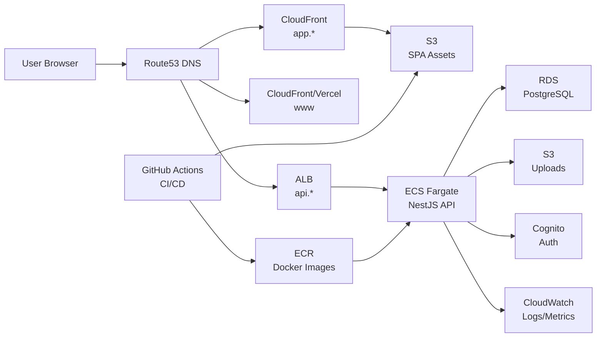

# Phase 8: Infrastructure & Deploy

## Goal

Deploy the entire stack to AWS using Terraform. Set up CI/CD pipelines, staging environment, and ship to production with confidence.

## Prerequisites

- Phase 7 complete (production-hardened API and web app)
- AWS account with appropriate permissions
- Domain `neighborhoodconnect.com` registered and Route53 hosted zone created
- Terraform >= 1.6 installed locally

---

## Tasks

### 8.1 Dockerize the API

**File:** `apps/api/Dockerfile` (new)

Create a production Docker image for the NestJS API:

```dockerfile
# Build stage
FROM node:20-alpine AS builder
WORKDIR /app
COPY package.json pnpm-lock.yaml pnpm-workspace.yaml ./
COPY apps/api/package.json apps/api/
COPY packages/types/package.json packages/types/
RUN corepack enable && pnpm install --frozen-lockfile

COPY packages/types/ packages/types/
COPY apps/api/ apps/api/
RUN pnpm --filter api prisma generate
RUN pnpm --filter api build

# Production stage
FROM node:20-alpine AS runner
WORKDIR /app
ENV NODE_ENV=production

COPY --from=builder /app/node_modules ./node_modules
COPY --from=builder /app/apps/api/dist ./dist
COPY --from=builder /app/apps/api/node_modules ./apps/api/node_modules
COPY --from=builder /app/apps/api/prisma ./prisma

EXPOSE 3000
CMD ["node", "dist/main.js"]
```

**Also add:**
- `.dockerignore` for `apps/api`
- `docker-compose.yml` update for local testing with Postgres
- Health check in Dockerfile: `HEALTHCHECK CMD curl -f http://localhost:3000/health || exit 1`

**Verify:** `docker build -t nc-api . && docker run -p 3000:3000 nc-api`

---

### 8.2 Terraform Modules

**Directory:** `infra/modules/` (following `docs/iac-terraform.md`)

Implement the 5 Terraform modules:

#### `infra/modules/network/`
- VPC with 2 public subnets + 2 private subnets (multi-AZ)
- Internet Gateway + NAT Gateway
- Route tables for public and private subnets
- Security groups:
  - ALB: allow 80/443 from anywhere
  - ECS: allow 3000 from ALB only
  - RDS: allow 5432 from ECS only

#### `infra/modules/database/`
- RDS PostgreSQL 16 instance (`db.t3.micro` for dev, `db.t3.small` for prod)
- DB subnet group (private subnets)
- Parameter group
- Automated backups (7-day retention)
- Encryption at rest enabled
- Outputs: `db_endpoint`, `db_port`

#### `infra/modules/app/`
- ECS Cluster
- ECS Fargate service + task definition
  - Container: API Docker image from ECR
  - Environment variables: `DATABASE_URL`, `COGNITO_ISSUER`, `COGNITO_CLIENT_ID`, `CORS_ORIGINS`
  - Health check: `GET /health`
  - Resources: 256 CPU, 512 MB memory (dev), 512 CPU, 1024 MB (prod)
- Application Load Balancer
  - HTTPS listener (ACM certificate)
  - HTTP → HTTPS redirect
  - Target group with health check
- ECR repository for API Docker images
- IAM roles: task execution role, task role (S3 access)
- Auto-scaling: 1–4 tasks based on CPU utilization

#### `infra/modules/storage/`
- S3 bucket: SPA static assets (`app.neighborhoodconnect.com`)
  - Bucket policy for CloudFront access
  - Website hosting configuration
- S3 bucket: User uploads (avatars)
  - CORS configured for direct browser uploads
  - Lifecycle rule: delete incomplete multipart uploads after 7 days
- CloudFront distribution:
  - Origin: S3 SPA bucket
  - Default root: `index.html`
  - Custom error response: 403/404 → `index.html` (SPA routing)
  - ACM certificate for `app.neighborhoodconnect.com`
  - Cache policy for static assets (1 year)

#### `infra/modules/auth/`
- Cognito User Pool
  - Email-based sign-up
  - Password policy: 8+ chars, mixed case, numbers
  - MFA: optional
  - Email verification enabled
- Cognito App Client
  - OAuth2 authorization code flow
  - Callback URLs for dev/staging/prod
  - Allowed OAuth scopes: openid, email, profile
- Cognito Domain: `auth.neighborhoodconnect.com`
- Outputs: `user_pool_id`, `client_id`, `domain`

---

### 8.3 Environment Configurations

**Directories:** `infra/envs/dev/`, `infra/envs/staging/`, `infra/envs/prod/`

Each environment gets its own:
- `main.tf` — module calls with environment-specific variables
- `variables.tf` — variable definitions
- `terraform.tfvars` — environment-specific values (git-ignored for secrets)
- `outputs.tf` — URLs, endpoints, IDs
- `backend.tf` — S3 remote state configuration

**Key differences:**

| Setting | Dev | Staging | Prod |
|---------|-----|---------|------|
| RDS instance | `db.t3.micro` | `db.t3.micro` | `db.t3.small` |
| ECS tasks | 1 | 1 | 2 |
| ECS CPU/memory | 256/512 | 256/512 | 512/1024 |
| RDS multi-AZ | No | No | Yes |
| CloudFront price class | `PriceClass_100` | `PriceClass_100` | `PriceClass_200` |
| Domain | `dev.*` | `staging.*` | `*` (root) |

**State management:**
```hcl
# backend.tf
terraform {
  backend "s3" {
    bucket         = "nc-terraform-state"
    key            = "dev/terraform.tfstate"  # per environment
    region         = "us-east-1"
    dynamodb_table = "nc-terraform-locks"
    encrypt        = true
  }
}
```

---

### 8.4 CI/CD Pipeline (GitHub Actions)

**Files:** `.github/workflows/`

#### `ci.yml` — Run on every PR

```yaml
name: CI
on: [pull_request]
jobs:
  lint-and-test:
    runs-on: ubuntu-latest
    steps:
      - uses: actions/checkout@v4
      - uses: pnpm/action-setup@v4
      - uses: actions/setup-node@v4
        with: { node-version: 20 }
      - run: pnpm install --frozen-lockfile
      - run: pnpm lint
      - run: pnpm test
      - run: pnpm build
```

#### `deploy-staging.yml` — Deploy on merge to `main`

```yaml
name: Deploy Staging
on:
  push:
    branches: [main]
jobs:
  deploy-api:
    runs-on: ubuntu-latest
    steps:
      - uses: actions/checkout@v4
      - name: Configure AWS credentials
        uses: aws-actions/configure-aws-credentials@v4
      - name: Login to ECR
        uses: aws-actions/amazon-ecr-login@v2
      - name: Build and push API image
        run: |
          docker build -t $ECR_REPO:$GITHUB_SHA -f apps/api/Dockerfile .
          docker push $ECR_REPO:$GITHUB_SHA
      - name: Update ECS service
        run: |
          aws ecs update-service --cluster nc-staging --service nc-api \
            --force-new-deployment

  deploy-web:
    runs-on: ubuntu-latest
    steps:
      - uses: actions/checkout@v4
      - run: pnpm install --frozen-lockfile
      - run: pnpm --filter web build
      - name: Deploy to S3
        run: aws s3 sync apps/web/dist/ s3://app-staging-bucket --delete
      - name: Invalidate CloudFront
        run: aws cloudfront create-invalidation --distribution-id $CF_ID --paths "/*"
```

#### `deploy-prod.yml` — Manual trigger for production

Same as staging but:
- Triggered manually (`workflow_dispatch`)
- Requires approval (GitHub Environments)
- Deploys to production infrastructure
- Runs smoke tests after deployment

---

### 8.5 Database Migration Strategy

**For production deployments:**

1. **Never auto-run migrations in production.** Run manually or in a CI step before API deploy.

2. **Migration workflow:**
   ```bash
   # Generate migration from schema changes
   cd apps/api
   pnpm prisma migrate dev --name <description>

   # Apply to staging
   DATABASE_URL=<staging_url> pnpm prisma migrate deploy

   # Apply to production (after staging validation)
   DATABASE_URL=<prod_url> pnpm prisma migrate deploy
   ```

3. **CI/CD integration:**
   - Add a "migrate" step in the deploy workflow before the API deploy
   - Use a dedicated migration ECS task (not the running service)

4. **Rollback plan:**
   - Keep a `down` migration for each `up` migration
   - Test rollbacks in staging before any production deploy

---

### 8.6 Staging Deploy + Smoke Tests

**File:** `.github/workflows/smoke-tests.yml`

After staging deploy, run automated smoke tests:

```typescript
// tests/smoke/api.test.ts
describe('API Smoke Tests', () => {
  const baseUrl = process.env.API_URL;

  it('health check returns 200', async () => {
    const res = await fetch(`${baseUrl}/health`);
    expect(res.status).toBe(200);
  });

  it('interests endpoint returns data', async () => {
    const res = await fetch(`${baseUrl}/v1/interests`, {
      headers: { 'x-user-id': 'smoke-test-user' },
    });
    expect(res.status).toBe(200);
    const data = await res.json();
    expect(data.length).toBeGreaterThan(0);
  });

  it('neighborhoods search works', async () => {
    const res = await fetch(`${baseUrl}/v1/neighborhoods/search?query=river`, {
      headers: { 'x-user-id': 'smoke-test-user' },
    });
    expect(res.status).toBe(200);
  });
});
```

---

### 8.7 Production Deploy Checklist

Create a runbook document for production deployments:

```markdown
## Pre-Deploy
- [ ] All tests passing on main branch
- [ ] Staging deploy successful and smoke tests green
- [ ] Database migration tested on staging
- [ ] No breaking API changes without frontend update
- [ ] CORS origins updated if domain changes

## Deploy
- [ ] Run database migration: `prisma migrate deploy`
- [ ] Deploy API: Update ECS service with new image
- [ ] Deploy Web: S3 sync + CloudFront invalidation
- [ ] Deploy Marketing: Next.js build + deploy

## Post-Deploy
- [ ] Health check passing: GET /health
- [ ] Manual smoke: login, create profile, discover, connect
- [ ] Monitor error rate in CloudWatch for 30 minutes
- [ ] Check Cognito auth flow works
- [ ] Verify HTTPS/TLS on all domains
```

---

### 8.8 Marketing Site SEO Finalization

**Files:** `apps/marketing/`

Complete SEO requirements:

1. **Sitemap** — Generate `sitemap.xml` with all marketing pages
   ```typescript
   // next-sitemap.config.js
   module.exports = {
     siteUrl: 'https://neighborhoodconnect.com',
     generateRobotsTxt: true,
   };
   ```

2. **Robots.txt** — Allow crawling, disallow admin routes
   ```
   User-agent: *
   Allow: /
   Disallow: /api/
   Sitemap: https://neighborhoodconnect.com/sitemap.xml
   ```

3. **Structured data** — Add JSON-LD to landing page:
   ```json
   {
     "@context": "https://schema.org",
     "@type": "WebApplication",
     "name": "Neighborhood Connect",
     "description": "Connect with nearby parents and pet parents",
     "url": "https://neighborhoodconnect.com"
   }
   ```

4. **OG images** — Generate OG images for each page (already partially done in layout.tsx)

5. **City pages** — Ensure `/cities/[city]` pages have unique meta descriptions and content

---

## Architecture Diagram (Final)



---

## Verification Checklist

After Phase 8 is complete, verify:

- [ ] Docker image builds and runs successfully
- [ ] `terraform plan` shows expected resources for each environment
- [ ] Dev environment deployed and accessible
- [ ] Staging environment deployed and accessible
- [ ] CI pipeline runs on every PR (lint, test, build)
- [ ] Staging auto-deploys on merge to main
- [ ] Smoke tests pass on staging
- [ ] Database migrations apply cleanly
- [ ] Production deploy works via manual trigger
- [ ] All domains resolve correctly (app, api, auth, www)
- [ ] HTTPS works on all domains
- [ ] CloudFront serves the SPA correctly (SPA routing works)
- [ ] Health check endpoint is accessible
- [ ] CloudWatch logs are visible
- [ ] Marketing site sitemap accessible at `/sitemap.xml`
- [ ] OG previews work when sharing URLs
